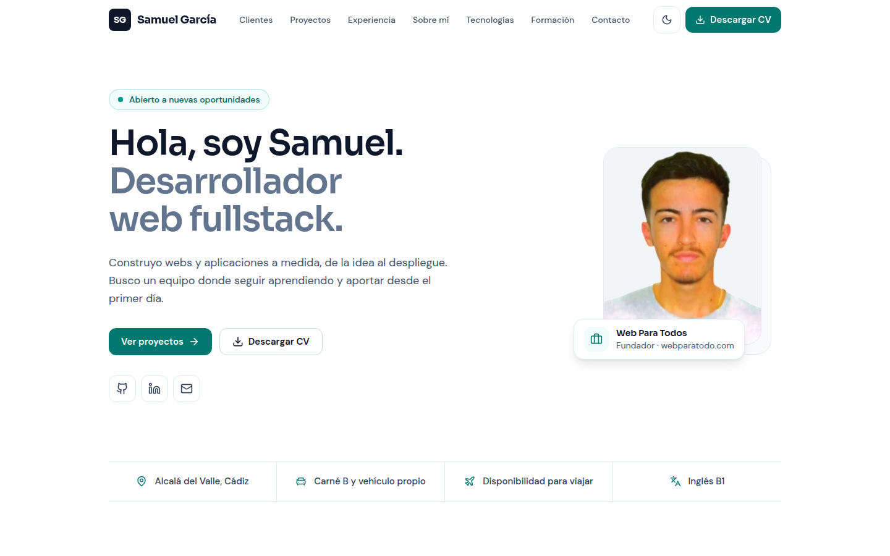
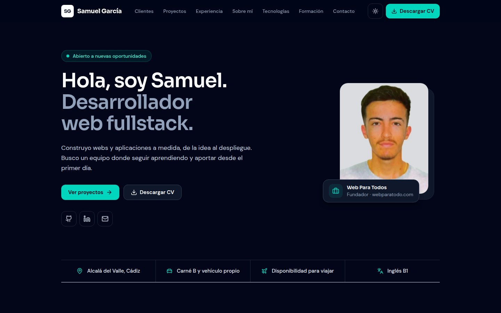
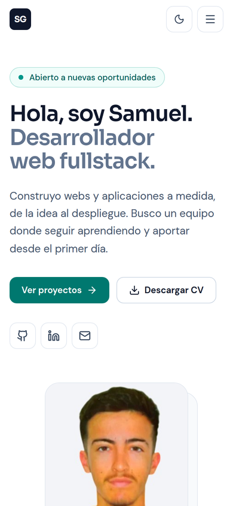
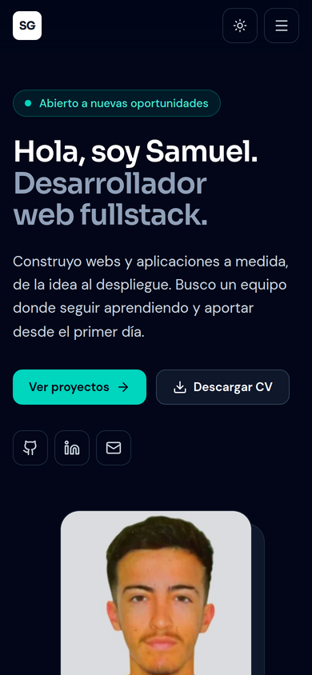

# Portafolio · Samuel García Ayala

Portafolio personal de **Samuel García Ayala**, desarrollador web fullstack.

**Web:** https://samuelgarcia-dev.com · **Empresa:** [webparatodo.com](https://webparatodo.com)

| Escritorio (claro) | Escritorio (oscuro) |
| --- | --- |
|  |  |

| Móvil (claro) | Móvil (oscuro) |
| --- | --- |
|  |  |

## Stack

- Angular 21: componentes standalone, signals, control flow (`@for` / `@if`) y sin zone.js
- Prerenderizado en la compilación (`outputMode: static`): el HTML llega con todo el contenido, sin servidor
- Tailwind CSS v4
- Iconos con [lucide-angular](https://lucide.dev)
- Fuentes Sora y DM Sans (Google Fonts)
- Alojada en Cloudflare Workers (archivos estáticos) con dominio propio

## Estructura

```
src/app/
├── core/                  # Servicio de tema claro/oscuro y utilidad de portapapeles
├── data/portfolio.data.ts # Todo el contenido (experiencia, proyectos, clientes...) tipado
└── sections/              # Un componente por sección
    ├── header/  hero/  about/  experience/  projects/
    └── clients/ skills/ education/ contact/ footer/
public/                    # cv.pdf, samuel.jpg, capturas (img/), favicon, Open Graph y _headers de Cloudflare
```

Para cambiar textos, proyectos o clientes solo hay que editar `src/app/data/portfolio.data.ts`.

## Desarrollo

```bash
npm install
npm start          # http://localhost:4200
npm run build      # compila en dist/portafolio/browser
```

## Despliegue

El Worker `portafolio` de Cloudflare está conectado a este repositorio: cada `push` a `main` compila y publica la web automáticamente.

| Ajuste | Valor |
| --- | --- |
| Build command | `npx ng build` |
| Deploy command | `npx wrangler deploy` |
| Configuración | `wrangler.jsonc` (sirve `dist/portafolio/browser`) |
| Node | 22 (fijado en `.node-version`) |

`public/_headers` define la caché de los archivos con hash y cabeceras de seguridad.
